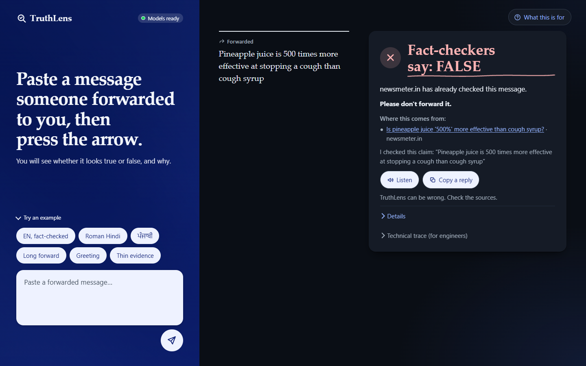
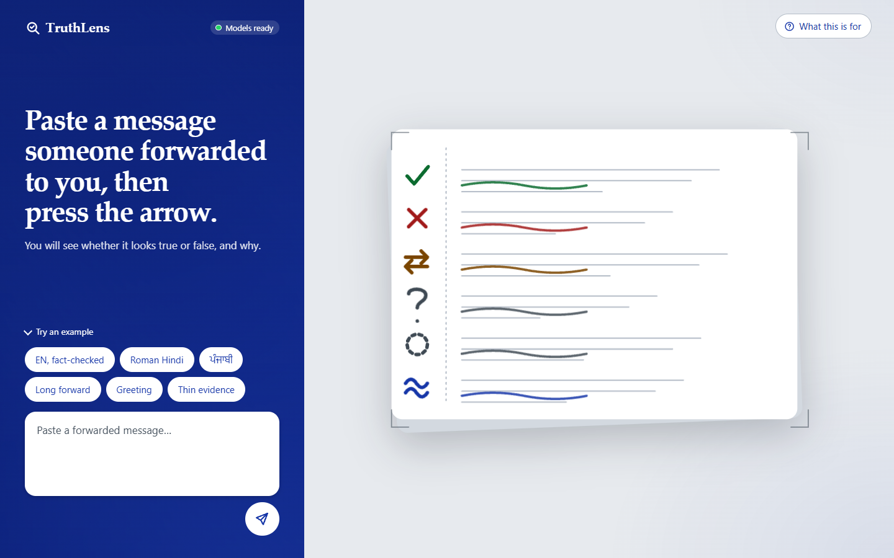
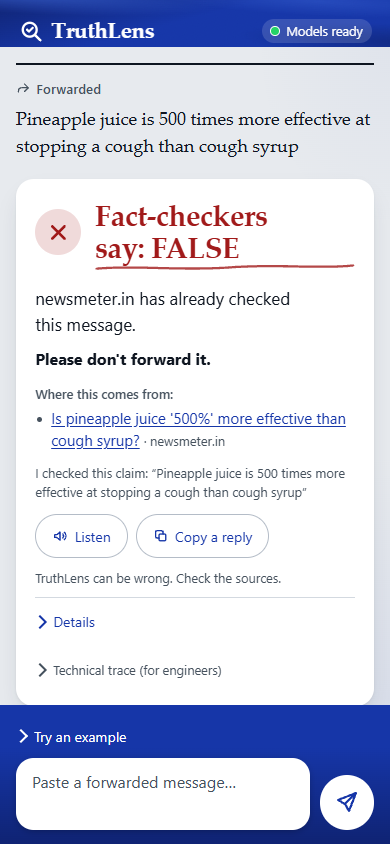
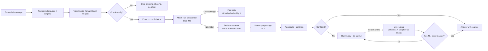

<div align="center">

# TruthLens

**Multilingual claim verification for forwarded messages, in English, Hindi and Punjabi, including Hindi and Punjabi typed in Latin letters.**

[](https://github.com/SoumiryaSarangi/TruthLens/actions/workflows/ci.yml)




</div>

> **Plain-language summary.** Someone sends you a message in a family group. You paste it into TruthLens. It tells you
> whether it has already been fact-checked, shows the sources, and says **"hard to say"** when it cannot decide. It never
> gives a verdict without showing where it came from.

---

## Table of contents

1. [Why this exists](#why-this-exists)
2. [Features](#features)
3. [How it works](#how-it-works)
4. [Results, and what they do not say](#results-and-what-they-do-not-say)
5. [Quick start](#quick-start)
6. [Using it](#using-it)
7. [Configuration](#configuration)
8. [Project structure](#project-structure)
9. [Development](#development)
10. [Documentation](#documentation)
11. [Limitations and responsible use](#limitations-and-responsible-use)
12. [Roadmap](#roadmap)
13. [Contributing, security and conduct](#contributing-security-and-conduct)
14. [License, data and citation](#license-data-and-citation)

---

## Why this exists

Most misinformation research is built for English news headlines. The messages that actually circulate in Indian family
groups are short, mixed-language, often typed in Roman script ("Kal se WhatsApp ke paise lagenge"), and frequently a
rewording of something a fact-checker already debunked. This project asks two questions:

1. **Can a system built for that input tell the reader what is known, in plain words, with its sources?**
2. **How much does typing Hindi or Punjabi in Latin letters cost a claim-verification pipeline?** (The research
   contribution: the *romanization penalty*, measured on identical posts.)

It is a CSE472 (Deep Learning for NLP) student project, built solo and documented to a standard where every number can
be traced to the run that produced it.

## Features

| | |
| --- | --- |
| **Three languages, two scripts** | English, Hindi and Punjabi in native script or romanized; answers follow the message's own script. |
| **Fact-check first** | Looks for a published fact-check of the same claim before reasoning over evidence, the way fact-checkers work. |
| **Honest about uncertainty** | A first-class "hard to say" result, visually distinct (grey, dashed) from "not enough evidence". Confidence is a band, calibrated out of sample. |
| **Sources on every verdict** | The card links the fact-check or quotes the source sentence; nothing is shown as true or false without one. |
| **Optional live look-up** | Per claim, on a button press: Wikipedia and Google Fact Check, judged by two NLI models that must agree. |
| **"Which words mattered"** | On a live verdict, an on-demand word view, shipped only because it passed a faithfulness rule fixed in advance. |
| **Responsive proof-desk UI** | One design from a phone to a wide laptop; light and dark; offline (system fonts, no CDN); reduced-motion safe; AA contrast. |
| **Reproducible** | Frozen splits, every result in `results/<config-hash>.json`, a report whose numbers are machine-checked. |

<table>
<tr>
<td width="62%"></td>
<td width="38%"></td>
</tr>
<tr><td align="center"><sub>Laptop, light theme</sub></td><td align="center"><sub>Phone: band, desk, composer dock</sub></td></tr>
</table>

## How it works



Two tracks, one served system. The **fast path** answers when a published fact-check matches closely. The **evidence
path** retrieves passages and reasons over them, and **abstains** when it is not confident. The offline lean of the
evidence path is *never shown as a verdict*: it appears only as the cautious "be careful" wording. A real verdict
comes only from a matched fact-check or from the validated live rule.

The served pipeline and the evaluated pipeline are the same code (`src/pipeline/`), so a reported number describes what
runs. The full design, stage contracts and failure handling are in [`docs/specs/SYSTEM_DESIGN.md`](docs/specs/SYSTEM_DESIGN.md)
and [`docs/ARCHITECTURE.md`](docs/ARCHITECTURE.md).

## Results, and what they do not say

Numbers carry the results file they came from (`results/<hash>.json`); `scripts/check_report_numbers.py docs/report.md`
verifies the report against those files. Accuracy is deliberately not the headline: on AVeriTeC the majority class
(Refuted) is about 61% of every split, so a constant answer "beats" published systems on accuracy.

| What | Result | Run |
| --- | --- | --- |
| Offline verdict, macro-F1 over 5 classes, locked test split | **0.2622** (always-Refuted 0.1447) | `0c41481ee90d` |
| Same, a control that never reads the evidence | **0.3085**: the pipeline does *not* beat it | `36e3f8e6094c` |
| Why: retrieval, gold document in the top 10 | 15.3% of test claims | `3cd7a0719b5b` |
| Confidence calibration, test ECE after scaling | 0.039 (0.066 before) | `c3128d753fc7` |
| Fast path at τ 0.90: share of posts answered, precision | 1.7%, 81% | `891eecc6a90e` |
| Romanization penalty on claim spans (token F1, identical posts) | Hindi −0.068, Punjabi −0.061 | report §7 |
| Live verdict, FEVER-style fresh claims, pre-registered rule | right on 100 of 106 answers, 3 false "Supported" in 225, answers about 3 claims in 10 | `docs/live-fever-protocol-2.md` |
| Live check on real-style claims (AVeriTeC dev, 500) | 61 verdicts shown, 56 of 56 decidable right, 0 false "Supported" in 305 | `80932a36cbf2` |
| Same check on 150 owner-written, forward-style claims | only 6 verdicts shown (4 right): **silent on 96%** | `80932a36cbf2` |
| Live fact-check match threshold 0.90 → 0.70, served, A2 + owner set | 56 shown, 51 of 52 decidable right, 0 false "Supported" in 205 | `f0d7ab316ff0` |

**Read these honestly.**

- **The system is accurate when it speaks and silent most of the time on real forwards.** Wikipedia and the fact-check
  index rarely hold a page that settles a local scam forward (diagnosis: `docs/silence-diagnosis-protocol.md`).
- **It is blind to negation.** A matched fact-check carries no polarity, so "X does *not* cure Y" can inherit the verdict
  of "X cures Y". On 39 fresh negated claims, every verdict it showed was wrong (11 of 11, 3 of them false
  "Supported"). A polarity guard reduced that to 3 wrong and none false "Supported", but **missed its pre-registered
  rule by one sentence on two items** and is served by an explicit owner decision, labelled post hoc
  (`docs/polarity-guard-v2-protocol.md`, run `b3a6fdfb6933`).
- **Validation is on FEVER-style and AVeriTeC claims and on owner-written claims, not on a sample of real WhatsApp
  traffic.** The owner-written sets are not collected forwards, and they say so.
- Several improvement attempts **failed their pre-registered checks and were not shipped**: better Wikipedia queries,
  a "be careful" cue rule, a fact-check "why" reader, alternative translation routes. They are reported with the same
  weight as the one that passed.

## Quick start

### Prerequisites

| | |
| --- | --- |
| Python | **3.11** (provisioned by [uv](https://docs.astral.sh/uv/); the system Python 3.13 is not supported) |
| Make | GNU Make (`winget install GnuWin32.Make` on Windows) |
| GPU | NVIDIA with **6 GB VRAM** for the full served stack (CUDA build of PyTorch); the test suite runs without a GPU |
| Disk | about 25 GB for the environment and model cache (21 GB of cached models on the development machine, 5 GB virtual environment); the datasets and built indexes are larger still (about 90 GB there, mostly raw downloads and caches). Running only the served demo needs far less data than rebuilding everything. |
| Optional | a Google Fact Check Tools API key for the live look-up (free) |

### Install

```bash
git clone https://github.com/SoumiryaSarangi/TruthLens.git
cd TruthLens
make setup            # uv provisions Python 3.11, installs the hash-pinned locks, wires pre-commit
make setup-ml         # the ML stack (PyTorch, transformers, FAISS), if you will run the models
```

Environment details, the GPU notes and Windows pitfalls are in [`docs/environment.md`](docs/environment.md).

### Run

```bash
make serve            # http://127.0.0.1:8000  (or: .venv/Scripts/python scripts/serve.py on Windows)
```

The server is ready after about a minute; the live-check models load in the background about 40 seconds later and
the first online check pays for any that are still loading. Models are downloaded from Hugging Face on first use.

To enable the live look-up, copy `.env.example` to `.env` and set `GOOGLE_FACTCHECK_API_KEY`. The file is git-ignored;
**never commit the key**.

### Verify the install

```bash
make lint             # ruff
make test             # the suite; ML tests skip without the models
python scripts/demo_check.py     # end-to-end on the demo chips; run with the server STOPPED; must print OK
```

## Using it

### The web page

Open `http://127.0.0.1:8000`, paste a forward, press the arrow. Example chips cover the demo paths (a fact-checked
claim, Roman Hindi, Punjabi, a long forward, a greeting, thin evidence). **"Search online"** on a card is the only thing
that sends text to Wikipedia and Google, and it says so on the button.

### The API

```bash
curl -s localhost:8000/verify -H "Content-Type: application/json" \
  -d '{"text": "Pineapple juice is 500 times more effective at stopping a cough than cough syrup",
       "include_trace": false}'
```

```json
{ "checkworthy": true,
  "results": [{ "path": "fast", "verdict": "Refuted", "abstained": false,
                "match": { "publisher": "newsmeter.in", "score": 0.919, "...": "..." },
                "explanation": "Already checked by newsmeter.in: ..." }] }
```

| Endpoint | Purpose |
| --- | --- |
| `POST /verify` | Check a message. Optional `live_search`, `force_claim`, `include_trace`. |
| `POST /explain_words` | The word view for a live Supported/Refuted verdict. |
| `GET /health` | Which stages are loaded. |
| `GET /version` | Git SHA, served configuration, confidence-band cut points. |

Full request and response reference: [`docs/API.md`](docs/API.md).

## Configuration

The served pipeline is one YAML file, [`configs/pipeline/dev.yaml`](configs/pipeline/dev.yaml), loaded by
`PipelineConfig`. The keys a deployer is most likely to touch:

| Key | Meaning |
| --- | --- |
| `tau_match` | Fast-path threshold on the offline fact-check index (0.90, chosen on dev). |
| `tau_live_match` | Threshold for a live Google fact-check hit (0.70, chosen by a pre-registered rule). |
| `live_search` / `live_verdict` / `live_translate` | The live look-up, the two-model verdict rule, and the English translation route. Off in every evaluation config. |
| `live_match_guard` | The polarity guard on fact-check matches (on by owner decision; see Results). |
| `word_view` | The on-demand "which words mattered" view. |
| `tau_abstain` | Abstention threshold of the offline evidence path. |

Every experiment is a config under `configs/` and writes `results/<config-hash>.json`.

## Project structure

```
TruthLens/
├── app/                 FastAPI server and the single-page UI
│   └── static/          index.html, app.js, styles.css, i18n/{en,hi,pa}.json, vendor/rail-shader.js
├── src/                 pipeline stages (preprocess, claims, matching, retrieval, stance,
│                        aggregation, generation, faithfulness, manipulation, live) and the harness (eval/)
├── configs/             one YAML per experiment; pipeline/dev.yaml is the served configuration
├── data/splits/         frozen splits (never regenerated); raw dataset text is local and git-ignored
├── docs/                report, specs, protocols, model card, API, architecture, operations
├── scripts/             measurement, plotting, demo checks, live-verdict tooling
├── tests/               ~900 tests, including leakage and frozen-split guards
├── results/             every experiment's results file, named by config hash
└── ui-src/              source of the one built front-end file (the shader rail)
```

## Development

```bash
make lint && make test            # before every commit; CI runs the same plus the leakage guards
make leakage                      # after ANY data change
make eval CONFIG=configs/<name>.yaml
make table                        # results/*.json -> docs/results.md
npm install && npm run build:rail # only when ui-src/ changes (rebuilds app/static/vendor/rail-shader.js)
```

**Rules the project keeps** (see [`CLAUDE.md`](CLAUDE.md) and [`CONTRIBUTING.md`](CONTRIBUTING.md)):

- Frozen splits are never regenerated; the test split was run **once** and nothing after it may change a reported number.
- No metric is computed outside `src/eval/evaluate.py`; every model sits beside a dumb baseline in the same table.
- A decision is taken by a rule written **before** the run and validated on fresh data. A choice made after seeing
  numbers is recorded as **post hoc**.
- The front end is vanilla JS and CSS, works offline, and the only built file is the shader bundle.

## Documentation

| Document | What it is |
| --- | --- |
| [`docs/report.md`](docs/report.md) | The report; every number carries its results hash. |
| [`docs/MODEL_CARD.md`](docs/MODEL_CARD.md) | Intended use, performance, limits and ethics of the system. |
| [`docs/ARCHITECTURE.md`](docs/ARCHITECTURE.md) | Components, data flow and the live check, in one place. |
| [`docs/API.md`](docs/API.md) | HTTP reference. |
| [`docs/DEPLOYMENT.md`](docs/DEPLOYMENT.md) | Deploying it: what to ship, GPU machine or tunnel, service, HTTPS, security checklist. |
| [`docs/OPERATIONS.md`](docs/OPERATIONS.md) | Running, resources, troubleshooting. |
| [`docs/specs/`](docs/specs/) | PRD, SRS, system design, UI/UX. |
| [`docs/project-log.md`](docs/project-log.md) | The running record of what was built, decided and corrected. |
| [`docs/acceptance.md`](docs/acceptance.md) | Every requirement, how it was verified, and its status. |
| [`PRODUCT.md`](PRODUCT.md) · [`DESIGN.md`](DESIGN.md) | Product context and the design system. |
| `docs/*-protocol.md` | The pre-registered protocols and their results. |
| [`CHANGELOG.md`](CHANGELOG.md) | Release notes. |

## Limitations and responsible use

TruthLens is a **decision aid for a reader, not an arbiter of truth.** Specifically:

- It can be wrong, and says so on every card. Check the sources.
- It does not judge opinions, predictions, religious or political beliefs, or health advice for an individual.
- It is silent on most real, local forwards; "hard to say" is the common honest outcome.
- Negation is an open weakness (see Results).
- It reads English, Hindi and Punjabi only; other languages are refused, not guessed.
- Romanized Punjabi translation is poor, and the translation model that would help does not fit a 6 GB GPU.
- Live look-up sends the claim text to Wikipedia and Google; the page says so before it does.

The full statement, including intended and out-of-scope uses, is in the [model card](docs/MODEL_CARD.md).

## Roadmap

Each item needs its own pre-registered protocol and fresh claims, per the project's rules.

- [ ] A guard for the Wikipedia evidence path's misreading of negated claims.
- [ ] A larger, newer fact-check index, and whole-article reading for the live check.
- [ ] Roman-script matching on the fast path (a pineapple claim scores 0.92 in English and 0.72 in Roman Hindi).
- [ ] A better romanized-Punjabi translator (needs more GPU memory or a different route).
- [ ] A usability study with the intended readers (`docs/usability-test.md`).

## Contributing, security and conduct

- Contributions: read [`CONTRIBUTING.md`](CONTRIBUTING.md). Small, one-change commits; tests and lint must pass.
- Security issues and exposed secrets: [`SECURITY.md`](SECURITY.md).
- Conduct: [`CODE_OF_CONDUCT.md`](CODE_OF_CONDUCT.md).

## License, data and citation

- **Code:** [MIT](LICENSE). Third-party models and datasets keep their own licences: [`THIRD_PARTY_NOTICES.md`](THIRD_PARTY_NOTICES.md).
- **Data:** AVeriTeC (CC BY-NC 4.0, **non-commercial**), MultiClaim (access-restricted, not redistributed), X-CLAIM,
  CheckThat! 2025 Task 2, Dakshina and FEVER are used under their own terms (`data/CLAUDE.md`). Raw dataset text is never
  committed. Wikipedia text shown in a live card is CC BY-SA 4.0 and keeps its link. Because the verdict components were
  trained on a non-commercial dataset, treat the trained artifacts as non-commercial.
- **Citation:** see [`CITATION.cff`](CITATION.cff).

Built by Soumirya Sarangi for CSE472.
