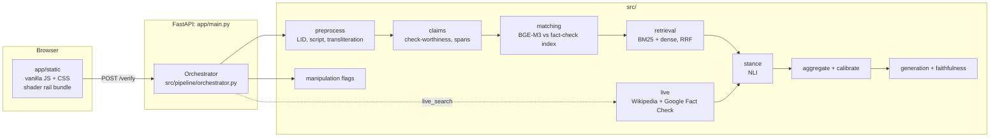
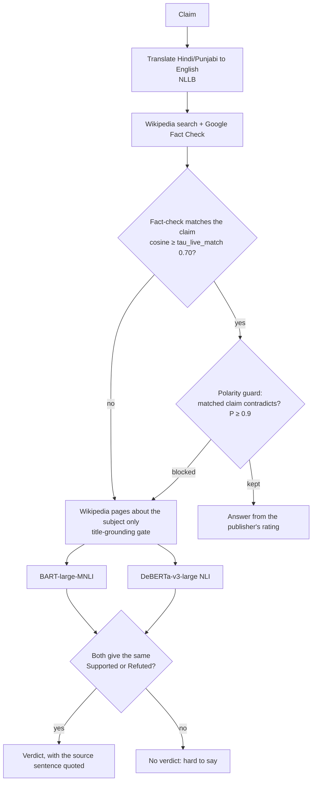

# Architecture

This is the one-page map. The authoritative contracts (stage interfaces, schemas, the GPU budget, failure handling) are in
[`specs/SYSTEM_DESIGN.md`](specs/SYSTEM_DESIGN.md); requirements and how each was verified are in
[`specs/SRS.md`](specs/SRS.md) and [`acceptance.md`](acceptance.md). If this page and the code disagree, the code wins.

## Design principles

1. **The served pipeline and the evaluated pipeline are the same code.** The API runs one forward through the stages; a batch
   runner runs the same stages over a frozen split. A reported number therefore describes what is served.
2. **Abstaining is a feature.** "Hard to say" is a first-class, visibly distinct result. An abstained result never gets
   generated prose.
3. **No verdict without a source.** A verdict comes only from a matched published fact-check or from the validated live
   rule. The offline guess is never presented as a verdict.
4. **Decisions are made by a rule written before the run.** Anything chosen after seeing numbers is recorded as *post hoc*.
5. **Optional means opt-in.** The live look-up runs only when the reader asks, per claim, and says what it sends.

## Components

| Layer | Where | Responsibility |
| --- | --- | --- |
| Client | `app/static/` | Render what `/verify` returns; never recompute a verdict, band or abstention. |
| API | `app/main.py` | Validation, Unicode normalisation, config load, health and version. |
| Orchestrator | `src/pipeline/orchestrator.py` | Stage order, the fast/evidence/live decisions, degradation, the polarity guard. |
| Stages | `src/{preprocess,claims,matching,retrieval,stance,aggregation,generation,faithfulness,manipulation}` | One typed function each, selected by a registry from `configs/pipeline/dev.yaml`. |
| Live check | `src/pipeline/live.py`, `src/retrieval/live/` | Source fetch (cached, rate-limited), relevance, grounding gate, two-model verdict rule. |
| Harness | `src/eval/` | The only place metrics are computed; writes `results/<config-hash>.json`. |

## The three ways an answer is made

### 1. Fast path (offline)

The claim is embedded with BGE-M3 and matched to a pre-built index of published fact-checks. A match at or above
`tau_match` (0.90, chosen on dev) answers "Already checked by *publisher*", using the publisher's own rating. It fires on
about 1.7% of posts at 81% precision, which is why it is conservative.

### 2. Evidence path (offline)

BM25 and dense retrieval are fused (RRF) over the demo corpus; each passage is labelled by an NLI model; an aggregator
turns the labels into a verdict and a calibrated confidence; below `tau_abstain` the result abstains. The explanation is
generated and then gated by an NLI faithfulness check, falling back to a template. This path's lean is shown only as a
cautious "be careful".

### 3. Live check (opt-in, per claim)

The two-model agreement rule (**V2**) was pre-registered and passed on 350 fresh FEVER-style claims; it is frozen, and
changing it needs a new protocol on fresh claims. Fact-check headlines are judged by their publisher's rating, never
by a model reading the headline.

## The front end

One responsive proof desk (breakpoints 760, 1100 and 1360 px), vanilla JS and CSS, system fonts, no CDN. The left rail's
living gradient is the only built artifact: `ui-src/rail-shader.jsx` is bundled by `npm run build:rail` into
`app/static/vendor/rail-shader.js`, loaded after first paint on a tablet width or wider with motion allowed, over an
always-present CSS gradient, and throttled so it does not compete with the models for the GPU. Details and the
measurements behind it: [`specs/UI_UX.md`](specs/UI_UX.md) and [`../DESIGN.md`](../DESIGN.md).

## Data flow and storage

- **Frozen splits** (`data/splits/`) hold ID manifests only; raw dataset text is local and git-ignored.
- **Indexes and caches** (`data/interim/`) are rebuilt by `make data` and its scripts.
- **Results** (`results/*.json`) are written per experiment, named by config hash, with git SHA and environment.
- **Live caches** hold fetched pages on disk; the API key is read from `.env` and redacted from every cache path and log.

## Failure handling

Every optional stage degrades instead of failing the request: a source that is down leaves the offline answer and records
`degraded: ...` in the trace; a failing flagger yields no flags; a failing guard keeps the match and says so. The only
hard failures are validation (`422`) and a failure of the offline stack itself.

## Resource budget

Designed for one 6 GB GPU. The served stack uses about 4.6 GiB of the roughly 4.9 GiB Windows leaves usable. The live-check
models are kept in CPU memory and moved to the GPU only while they run. **A second GPU process alongside the server
will run out of memory**: stop the server before running GPU scripts ([`OPERATIONS.md`](OPERATIONS.md)).
