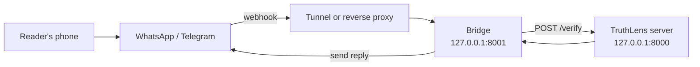

# Connecting TruthLens to a messaging app (WhatsApp, with fallbacks)

**Status: a researched plan, not built.** Nothing in this file is implemented yet. It records how to connect TruthLens to
WhatsApp through Meta's official WhatsApp Cloud API (**route A, preferred**), and what to switch to if A does not work on the
day: Twilio's WhatsApp sandbox (**route B**) or a Telegram bot (**route D**). Section 6 walks through each route step by step
for both ways of hosting it: a **VM** with a public address, or **your own GPU machine plus a tunnel**.

The web page and every number in the report are unaffected: this adds an interface, not a model. When it is built, the PRD's
non-goal "A real WhatsApp bot" ([`specs/PRD.md`](specs/PRD.md)) must be updated, and the build should follow the usual
plan, approval, build order with tests using recorded sample payloads.

Facts below come from the providers' own documentation, read on 2026-10-13. Where a page did not say something, the text
says so. These platforms change often; **re-check the linked pages before you rely on a detail**, especially prices, limits
and the API version.

## 1. The three routes at a glance

| | **A. Meta WhatsApp Cloud API** | **B. Twilio WhatsApp sandbox** | **D. Telegram bot** |
| --- | --- | --- | --- |
| Official WhatsApp? | **Yes** (Meta) | Yes (a Meta partner) | No, a different app |
| Looks like the real thing | A test number from Meta | A shared Twilio number with the Twilio logo | Telegram |
| Accounts needed | Facebook account, Meta developer account | Twilio account | Telegram account |
| Setup time (rough) | 1 to 3 hours | 30 to 60 minutes | 15 minutes |
| Who can message the bot | **Up to 5 numbers you add** and verify | Anyone who sends the join code, for **3 days** | Anyone with the bot link |
| Cost for a demo | Free for the test number | Trial credit (100 WhatsApp messages in trial units); then per message | Free |
| Replies with buttons | Yes, up to 3 reply buttons per message | Not covered by the sandbox page; use a plain-text keyword instead | Yes, inline keyboard |
| Needs a public HTTPS URL | Yes (webhook) | Yes (webhook) | **No**, if you use long polling |
| Biggest risk | Meta onboarding friction | The sandbox's 3-day join expiry and shared number | It is not WhatsApp |
| Use it when | **First choice** | A is blocked or stalled | Last resort, to still show a chat bot |

## 2. What is common to all three: the bridge

Build **one small separate service**, the *bridge*, in front of the existing app. It never touches the models.



Why a separate process:

- **The main app is never exposed.** Only the bridge faces the internet, and it authenticates every call by the
  provider's signature or secret, so the web page's password and the webhook do not clash.
- It can be replaced per provider without touching `app/`.
- A bridge crash does not take the models down, and vice versa.

What the bridge does, for any provider:

1. **Verify** the request is really from the provider (signature or secret header; section 3).
2. **Acknowledge immediately** (HTTP 200) and do the work in the background. A check can take seconds, and providers retry
   slow or failing webhooks. Deduplicate by message ID, because retries happen.
3. **Allowlist** the sender. One GPU serves one check at a time and the live look-up spends a Google quota, so only your own
   and your testers' numbers are answered. Anyone else gets nothing, or a short "not available" line.
4. **Call the existing `/verify`** with the message text (offline by default, `live_search` false).
5. **Format a plain-text reply**: the verdict in words, one reason, the source link, "TruthLens can be wrong". Words, never
   colour or emoji alone; no exclamation marks; answer in the message's own script. Keep under the provider's length limit
   (Telegram 4096 characters; WhatsApp interactive body 1024).
6. **Offer the online look-up as a choice**, to keep the project's consent rule: reply first with the offline answer plus a
   "Search online" button (or the keyword `LIVE` where buttons are not available). Only if the reader taps does the bridge
   call `/verify` again with `live_search: true`.
7. **Say plainly what it cannot do**: images, voice notes and documents are not checked.
8. **Store nothing** beyond a short-lived duplicate-ID cache; log only IDs and timings, never message text.

Configuration is environment variables, never files in git: provider tokens, the app secret or auth token, the verify
token, the allowlist (`MSG_ALLOWED`), and the base URL of the app (`http://127.0.0.1:8000`).

A sample reply (English; Hindi and Punjabi follow the message's script):

```
Fact-checkers say: FALSE.
newsmeter.in has already checked this message.
Please don't forward it.
Source: https://...
TruthLens can be wrong. Check the source.

[ Search online ]
```

## 3. Security you must keep, on every route

- **Verify every request.** Meta: `X-Hub-Signature-256`, an HMAC-SHA256 of the raw body keyed by your *app secret*.
  Twilio: `X-Twilio-Signature`, an HMAC-SHA1 over the exact URL plus the sorted form parameters, keyed by your auth token
  (use Twilio's `RequestValidator`; a 403 usually means the URL you validate against differs from the one Twilio called).
  Telegram: the `secret_token` you set, sent back in `X-Telegram-Bot-Api-Secret-Token`.
- **Secrets in the environment only.** Access tokens, app secret, auth token and bot token are as sensitive as the Google
  key: never in git, logs, screenshots or a chat. Rotate any that leak.
- **TLS is required.** Meta does not support self-signed certificates for webhooks; use a real certificate (Caddy,
  a tunnel provider).
- **Do not put the web page's basic-auth in front of the webhook path**, or the provider's calls will be refused. Expose
  only the bridge (recommended), or in a single proxy exclude the webhook path from basic auth (section 6.1).
- **Allowlist senders** (above) and rate-limit.
- **Tell testers** that their messages are processed by TruthLens and by the messaging provider.

## 4. Choosing the hosting case

| | **Case 1: a VM** | **Case 2: your GPU machine plus a tunnel** |
| --- | --- | --- |
| Where TruthLens runs | A rented GPU machine (see [`DEPLOYMENT.md`](DEPLOYMENT.md)) | Your laptop or desktop with the GPU |
| Public address | A domain you point at the VM; a real certificate from Caddy | A tunnel gives you an HTTPS URL |
| Stable URL? | **Yes** | **Quick tunnels change every run**; use a named tunnel on your own domain for a stable one |
| Provider webhook after a restart | Unchanged | Quick tunnel: **re-enter the new URL** every time |
| Depends on | The VM being up | Your laptop awake, plugged in, online, GPU free |
| Best for | A link that stays up for days | A demo you control, for an hour |

Both cases use the same bridge and the same provider steps; only the **webhook URL** and **where the processes run**
differ. Section 6 gives the commands for each.

## 5. Accounts and things to prepare in advance

Do these a day early; some involve verification codes.

| For | You need |
| --- | --- |
| **A** | A Facebook account; Meta developer registration; a phone with WhatsApp to be a test recipient (plus up to 4 more testers' numbers) |
| **B** | A Twilio account (a trial is enough); a phone with WhatsApp |
| **D** | A Telegram account |
| All | The deployed or local TruthLens server working; your Google Fact Check key; a way to expose the bridge (a domain and Caddy on a VM, or a tunnel tool such as `cloudflared` or `ngrok` for case 2) |

## 6. Step by step

Throughout, `BRIDGE_URL` means the public HTTPS address that ends at the bridge, for example
`https://your-domain.example/whatsapp/webhook` (case 1) or `https://<random>.trycloudflare.com/whatsapp/webhook`
(case 2). The path is yours to choose; use the same one everywhere.

### 6.0 Make the bridge reachable

**Case 1, a VM.** The bridge listens on `127.0.0.1:8001`. Let Caddy send only the webhook path to it and keep the web
page behind its password:

```caddyfile
your-domain.example {
    # The provider's calls: authenticated by signature, so NO basic_auth here.
    handle /whatsapp/webhook* {
        reverse_proxy 127.0.0.1:8001
    }
    # Everything else (the web page) stays behind a password.
    handle {
        basic_auth {
            reader PASTE_THE_HASH_HERE
        }
        reverse_proxy 127.0.0.1:8000
    }
}
```

**Case 2, your GPU machine plus a tunnel.** Start the app and the bridge locally, then tunnel **only the bridge's port**:

```bash
cloudflared tunnel --url http://localhost:8001      # prints https://<random>.trycloudflare.com
```

Tunnelling the bridge, not the app, keeps the web page and the GPU server off the internet. The printed address **changes
each time you start the tunnel**: re-enter it in the provider's settings every time (steps below), or create a *named*
tunnel on a domain you own for a fixed address. (Tunnel tools change; follow the tool's current instructions. ngrok works
the same way with `ngrok http 8001`.)

### 6.A Route A: Meta WhatsApp Cloud API

1. **Developer account.** Sign in to Meta for Developers with your Facebook account and complete developer registration.
2. **Create the app.** App Dashboard, **Create App**, name and email, choose the use case **Connect with customers through
   WhatsApp**, pick or create a business portfolio, **Create app**.
3. **Open the API.** Click **Start using the API**; connect the app to a WhatsApp Business account (select one or create
   one). Meta creates a **test business phone number** for you automatically, with relaxed limits and no payment method
   required for test messages.
4. **Note three values**: the **test phone number ID**, the **WhatsApp Business account ID**, and the **app secret**
   (App settings, Basic). Keep them in your environment file, not in git.
5. **Add recipients.** In API Setup, add the phone numbers allowed to talk to the test number (**up to 5**); each receives a
   verification code on WhatsApp. A number that is not on the list gets error **#131030** ("recipient phone number not in
   allowed list").
6. **Send the first test message** from the API Setup page (generate a temporary token, From = the test number, To = your
   number). Reply to it from your phone: this opens the **24-hour window** in which you may send free-form (non-template)
   messages.
7. **Make a permanent token.** The temporary token expires quickly. In Business Settings, **System users**, **Add**; assign
   the app (**Manage app**) and the WhatsApp account (**Manage WhatsApp Business accounts**, full control); **Generate
   token** with the permissions `business_management`, `whatsapp_business_messaging` and
   `whatsapp_business_management`. Store it securely.
8. **Start the bridge** with `MSG_PROVIDER=meta`, the permanent token, the phone number ID, the app secret, a **verify
   token you invent** (any long random string), and `MSG_ALLOWED` set to your verified numbers. Start the TruthLens server
   too, and make the bridge reachable (6.0).
9. **Register the webhook.** In the app, **WhatsApp, Configuration**: callback URL = `BRIDGE_URL`, verify token = the
   string from step 8, **Verify and save**. Meta sends a `GET` with `hub.mode=subscribe`, `hub.challenge` and
   `hub.verify_token`; the bridge must answer `200` with the challenge value, or it is not saved.
10. **Subscribe** to the **messages** field.
11. **Try it.** From a verified number, send a message (or forward one) to the test number. The webhook `POST` carries
    `entry[].changes[].value.messages[]` with `from`, `id`, `type` and `text.body`; a forwarded message additionally has
    `context.forwarded` (forwarded up to 5 times) or `context.frequently_forwarded` (more than 5). The bridge replies
    through `POST https://graph.facebook.com/<VERSION>/<PHONE_NUMBER_ID>/messages` with the bearer token. Use the API
    version shown in Meta's current documentation (the pages showed v23.0 and v26.0).
12. **Buttons.** The "Search online" choice is an interactive reply-button message (up to 3 buttons, title up to 20
    characters, body up to 1,024). When tapped, the webhook delivers `type: interactive` with
    `interactive.button_reply.id`.

**Per-hosting notes**

- *Case 1 (VM):* steps 8 to 10 once; the webhook stays valid. Run the bridge as a second systemd service beside
  `truthlens.service`.
- *Case 2 (tunnel):* every new quick-tunnel URL means repeating **step 9** (the URL field). Start order each time: app,
  bridge, tunnel, then update the callback URL and press Verify. Keep the laptop plugged in and the GPU idle of other work.

**Limits and costs to know**

- The test number cannot serve the public; a real number needs business verification and display-name approval, which the
  pages read did not cover and which can take days.
- Meta retries failed deliveries for up to 7 days, so a bridge that was down may receive a burst when it returns;
  deduplicate by message ID. Updates can arrive batched (up to 1,000 per `POST`).
- **Price:** free for the test number. For anything beyond it, check Meta's pricing page: one industry source reports that
  from **1 October 2026** service messages inside the 24-hour window stop being free, with the first 1,000 service messages
  per business number per month free. That figure was not confirmed on Meta's own page.

### 6.B Route B: Twilio WhatsApp sandbox (if A is blocked)

1. **Create a Twilio account** and verify your phone.
2. **Open the sandbox.** Twilio documents it on the *Try WhatsApp* page of the console
   (`twilio.com/console/sms/whatsapp/sandbox`, in the legacy console; trial accounts on the new console use *Try out
   WhatsApp*). Accept the terms.
3. **Join.** From your phone send `join <your-two-word-code>` to the shared sandbox number (+1 415 523 8886 in the
   documentation). Twilio confirms. **The join lasts three days; rejoin after that.** Everyone who should chat with it must
   do the same.
4. **Start the bridge** with `MSG_PROVIDER=twilio`, your **auth token**, and `MSG_ALLOWED` (the `whatsapp:+<number>`
   senders). Make it reachable (6.0).
5. **Point Twilio at it.** Sandbox settings, **When a message comes in** = `BRIDGE_URL`, method **POST**. Optionally set
   the **status callback URL**.
6. **How it behaves.** Twilio posts form fields: `Body` (the text), `From` (`whatsapp:+<E.164>`), `To`, and `MediaUrl0` for
   media. The bridge replies with TwiML (`<Response><Message>...</Message></Response>`) or by the REST API. Validate
   `X-Twilio-Signature` against the **exact** public URL you entered.
7. **"Search online".** The sandbox page says business-initiated messages must use pre-approved templates and does not
   cover interactive buttons, so do not depend on a button here. Use a plain-text instruction, *"Reply LIVE to search
   online."*, and treat a `LIVE` reply as the choice.

**Per-hosting notes**

- *Case 1 (VM):* the URL in step 5 is permanent.
- *Case 2 (tunnel):* update step 5 each time the tunnel URL changes, and note a mismatch between the tunnel URL and the one
  used for signature validation is the usual cause of a `403`.

**Limits to know** (from Twilio's sandbox page): you can only message users who have joined (otherwise error 63015); one
message per three seconds; functional testing only; the number shows the Twilio logo; trial accounts include 100 WhatsApp
messages in trial units, then standard WhatsApp pricing; moving beyond the sandbox needs your own registered sender
(WhatsApp self sign-up or a tech-provider arrangement).

### 6.D Route D: Telegram bot (last resort, and the easiest)

Not WhatsApp, but it demonstrates the same experience with almost no setup and, with long polling, **needs no public URL
or tunnel at all**.

1. In Telegram, open **@BotFather**, send `/newbot`, choose a name and a username; it returns the **bot token**. Treat it as
   a secret: anyone with it controls the bot.
2. **Choose how updates arrive.**
   - **Long polling (easiest, recommended for case 2):** the bridge repeatedly asks Telegram for updates
     (`getUpdates`), which needs only outbound internet. No tunnel, no domain, no certificate. It does not work while a
     webhook is set (delete the webhook first with an empty-URL `setWebhook`).
   - **Webhook (for case 1):** `setWebhook` with `url=BRIDGE_URL` and a `secret_token` (1 to 256 characters of
     `A-Z a-z 0-9 _ -`); Telegram then sends the secret in `X-Telegram-Bot-Api-Secret-Token`. Allowed webhook ports are
     443, 80, 88 and 8443.
3. **Start the bridge** with `MSG_PROVIDER=telegram`, the bot token and, for webhook mode, the secret; `MSG_ALLOWED` holds
   chat IDs (or leave open for a short demo, accepting the quota risk).
4. **How it behaves.** An update has `update_id` and `message.chat.id`, `message.text`; a forwarded message carries
   `message.forward_origin`. The bridge replies with `sendMessage(chat_id, text)` (4096 characters at most). The "Search
   online" choice is an **inline keyboard** button; its tap arrives as a `callback_query` update.
5. **Try it.** Open the bot's link, press **Start**, forward a message to it.

**Per-hosting notes**

- *Case 1 (VM):* use the webhook, or just long polling from the VM; both work.
- *Case 2 (GPU machine):* use **long polling**; nothing to expose, nothing to re-register.

## 7. If route A fails on the day

Decide in advance, and rehearse the fallback once.

| Symptom | Likely cause | Do this |
| --- | --- | --- |
| Meta will not verify the webhook | Verify token mismatch, or the bridge did not return the challenge, or the URL changed | Check the verify token string; open the bridge URL in a browser (`GET` with `hub.challenge`); re-enter the new tunnel URL |
| Messages arrive but no reply | Token expired (temporary token), recipient not on the list (#131030), or outside the 24-hour window | Use the permanent token; add the recipient; message the number first |
| It worked, then silence | The quick tunnel restarted with a new URL | Re-enter the callback URL; verify again |
| Meta onboarding stalls | Account verification or app review friction | **Switch to B** (about 30 to 60 minutes) |
| B's join expired | Three-day sandbox expiry | Rejoin with `join <code>` |
| Neither WhatsApp route works | Provider or network problem | **Switch to D** and tell the audience it is the same engine on a different channel; play the recorded WhatsApp demo |

Always have a **screen recording** of the working WhatsApp exchange made the day before, and the web page ready as the
final fallback: it shows the same system without any third party.

## 8. Demo script that fits a chat

1. Forward the pineapple message: a published fact-check, answered in about a second.
2. A Roman Hindi forward: the answer follows the message's script.
3. A greeting: "this is not a claim", with no verdict.
4. A "hard to say" case, then tap **Search online** to show that the live look-up happens only on request.
5. Say what it cannot do: images, voice notes, documents, and negated claims it can misread
   ([`MODEL_CARD.md`](MODEL_CARD.md)).

## 9. What building this involves (when you decide to)

- A `src/messaging/` package with one adapter per provider (normalise the incoming request, send a reply) and a small
  FastAPI app for the bridge: roughly 300 lines plus tests.
- Tests with **recorded sample payloads** from each provider's documentation (the Meta text and button payloads quoted
  above, a Twilio form post, a Telegram update), signature-verification tests with fixed secrets, an allowlist test and a
  duplicate-ID test. No network in tests.
- A `scripts/run_bridge.py` launcher and a systemd unit beside the app's.
- Spec updates: the PRD non-goal, a short messaging section in `UI_UX.md`, and an entry in the changelog and project log.
- Roughly one day of work, plus the account setup in section 5, which depends on the provider.

## Sources (read 2026-10-13)

- Meta: [WhatsApp Cloud API: Get started](https://developers.facebook.com/documentation/business-messaging/whatsapp/get-started),
  [Create a webhook endpoint](https://developers.facebook.com/documentation/business-messaging/whatsapp/webhooks/create-webhook-endpoint),
  [Text message webhook reference](https://developers.facebook.com/documentation/business-messaging/whatsapp/webhooks/reference/messages/text),
  [Interactive reply buttons](https://developers.facebook.com/documentation/business-messaging/whatsapp/messages/interactive-reply-buttons-messages),
  [Webhook setup (older docs)](https://developers.facebook.com/docs/whatsapp/cloud-api/guides/set-up-webhooks/),
  [Cloud API get started (older docs, recipient limit)](https://developers.facebook.com/docs/whatsapp/cloud-api/get-started/)
- Pricing change report (a third party; confirm on Meta's page): [respond.io](https://respond.io/blog/whatsapp-pricing-change-2026)
- Twilio: [WhatsApp sandbox](https://www.twilio.com/docs/whatsapp/sandbox),
  [WhatsApp API](https://www.twilio.com/docs/whatsapp/api),
  [Webhook security](https://www.twilio.com/docs/usage/webhooks/webhooks-security),
  [Quickstart](https://www.twilio.com/docs/whatsapp/quickstart)
- Telegram: [Bot API](https://core.telegram.org/bots/api), [Webhooks guide](https://core.telegram.org/bots/webhooks)
